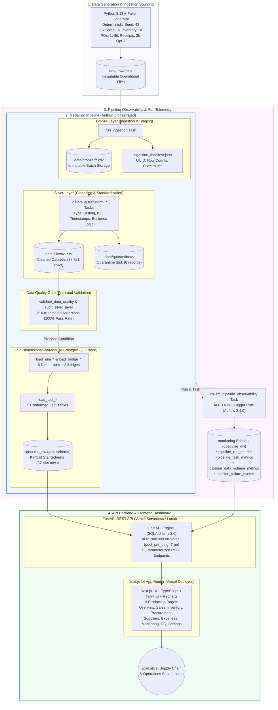

# OpsPulse — System Architecture & Technical Specifications

**Project:** OpsPulse  
**Document Version:** 2.0 (Production Implemented Architecture)  
**System Status:** Fully Implemented, Verified, and Production-Deployed  
**Industry Domain:** Retail, Supply Chain & Operations Analytics  

---

## 1. Architectural Overview

OpsPulse is an enterprise-grade, end-to-end data platform engineered to solve operational data fragmentation across retail sales, multi-facility inventory, vendor procurement, dock logistics, and operating expenditures.

The system implements a decoupled, modern Data Engineering architecture that ingests transactional operational data, processes it through a strict **Medallion Architecture (Bronze $\rightarrow$ Silver $\rightarrow$ Gold)**, validates integrity through a **210-assertion Data Quality Gate**, orchestrates tasks using **Apache Airflow 3.4.0**, models data into a **Kimball Star Schema Data Warehouse** on PostgreSQL / Neon, exposes analytics via a high-performance **FastAPI REST API**, and renders insights across a responsive **Next.js 14 Analytical Dashboard**.

```
┌─────────────────────────────────────────────────────────────────────────────────────────────────────────┐
│                                       OPSPULSE SYSTEM ECOSYSTEM                                         │
└─────────────────────────────────────────────────────────────────────────────────────────────────────────┘
   [ Python / Faker Generator ]  ──►  20k Sales, 9k Inv, 3k PO, 1.4k Receipts, 2k OpEx
                │
                ▼
   [ Bronze Ingestion Layer ]   ──►  Immutable Raw CSVs + JSON Manifests (UUID, Batch Metadata)
                │
                ▼
   [ Silver Cleansing & Rules ] ──►  ISO-8601 Timestamps, Type Casting, Quarantine Sink (0 Quarantined)
                │
                ▼
   [ Data Quality Gate ]        ──►  210 Automated Assertions (Completeness, Uniqueness, Referential)
                │
                ▼
   [ Gold Data Warehouse ]      ──►  PostgreSQL / Neon (8 Dims, 2 Bridges, 5 Facts, 37,464 Rows)
                │
                ├─────────────────────────────────────────────────┐
                ▼                                                 ▼
   [ Airflow 3.4.0 Orchestrator ]                    [ FastAPI REST API (12 Endpoints) ]
   (30 Tasks, 28.32s, monitoring schema)             (SQLAlchemy 2.0, NullPool Serverless)
                                                                  │
                                                                  ▼
                                                     [ Next.js 14 Frontend Dashboard ]
                                                     (9 Pages, Tailwind CSS, Recharts)
```

---

## 2. Implemented End-to-End System Architecture



---

## 3. Technology Stack & Component Specifications

| Tier / Subsystem | Implemented Technology | Version | Architectural Responsibility |
| :--- | :--- | :--- | :--- |
| **Data Generation** | Python, Faker | 3.13 / 40.44 | Generates deterministic multi-domain enterprise data with cross-domain referential integrity. |
| **Orchestration** | Apache Airflow | 3.4.0 (WSL) | DAG scheduling, task sequencing, retry policies, dependency management, and XCom communication. |
| **Data Cleansing** | Pandas, NumPy | 2.2 / 2.1 | Data type casting, ISO-8601 normalization, business rule validation, null imputation, quarantine routing. |
| **Quality Framework** | Python Assertions | Custom | 210 pre-load validation checks across Completeness, Uniqueness, Validity, Referential Integrity, and Business Logic. |
| **Relational DW** | PostgreSQL / Neon | 16 / Serverless | Kimball Star Schema housing 8 dimensions, 2 bridge tables, 5 fact tables, and 4 telemetry tables. |
| **ORM & Connectivity**| SQLAlchemy, Psycopg 3 | 2.0 / 3.2 | High-throughput connection pooling with runtime-aware `NullPool` serverless compatibility. |
| **Backend REST API** | FastAPI, Pydantic v2 | 0.115 / 2.10 | 12 high-performance endpoints delivering sub-second response times with parameterized SQL queries. |
| **Frontend Framework**| Next.js (App Router) | 14.2.35 | Server-rendered and client-hydrated analytical dashboard with 9 domain views. |
| **UI Components** | Tailwind CSS, Lucide | 3.4 / 0.44 | Custom modern dark/light styling, fluid grids, and accessible data visualizations. |
| **Charting Engine** | Recharts | 2.15 | Responsive financial curves, dual-axis trends, category donuts, and pipeline duration charts. |
| **Cloud Hosting** | Vercel Platform | Serverless | Dual-project deployment: Next.js Frontend (`ops-pulse-dashboard`) + FastAPI Backend (`ops-pulse-lake`). |
| **Automated Testing**| Pytest, TestClient | 9.2 / 0.115 | 19 integration API tests and 129+ automated tests across data transformations, schema validation, and routes. |

---

## 4. Medallion Pipeline Architecture

The pipeline processes data through three rigorous Medallion stages, ensuring full reproducibility, auditability, and traceability:

```
┌──────────────────┐       ┌──────────────────┐       ┌──────────────────┐
│   BRONZE LAYER   │  ──►  │   SILVER LAYER   │  ──►  │    GOLD LAYER    │
│  Raw & Manifests │       │ Clean & Validated│       │Dimensional Models│
│   37,721 rows    │       │   37,721 rows    │       │   37,464 rows    │
└──────────────────┘       └──────────────────┘       └──────────────────┘
         │                          │                          │
         ▼                          ▼                          ▼
   Immutable CSVs            Automated Quarantine         Star Schema
  Batch UUID Tracking         0 Records Rejected        15 Conformed Tables
```

### 4.1 Bronze Layer (Raw Staging & Ingestion)
- **Role:** Preserves raw source records exactly as extracted from operational sources.
- **Storage Location:** `data/bronze/<batch_id>/`
- **Manifest Architecture:** Every batch produces an immutable `ingestion_manifest.json` detailing:
  - Batch UUID and execution start/end timestamps.
  - Per-file SHA-256 checksums, byte sizes, and record counts.
  - Schema definitions and source origin identifiers.
- **Batch Isolation:** Ingestion is organized into isolated batch directories (e.g., `batch_20261115_051056_1d64c5da`), enabling complete idempotency and replayability.

### 4.2 Silver Layer (Cleansing, Standardization & Quarantine)
- **Role:** Enforces data quality, structural integrity, business logic, and standard types.
- **Storage Location:** `data/silver/<batch_id>/`
- **Transformation Operations:**
  - Date and time standardization to ISO-8601 (`YYYY-MM-DD` and `YYYY-MM-DDTHH:MM:SSZ`).
  - Strict type casting for numeric values (currency to `Decimal`, quantities to `Integer`).
  - Whitespace trimming, case normalization, and phone/email pattern formatting.
  - Financial consistency validations: $\text{Gross Revenue} - \text{Discount Amount} = \text{Net Revenue}$.
  - Inventory balance validations: $\text{Quantity on Hand} \ge 0$.
- **Automated Quarantine Routing:** Invalid or anomalous records are segregated into `data/quarantine/<batch_id>/` alongside structured JSON quarantine audit logs explaining the exact failure reason. In the production baseline run, zero records were quarantined (`Quarantine = 0`).

### 4.3 Data Quality Gate
- **Role:** Circuit-breaker gate that blocks Gold warehouse loading if critical data quality standards are breached.
- **Assertion Coverage (210 Checks Total):**
  - **Completeness (42 checks):** Ensures zero nulls in primary keys, foreign keys, and mandatory operational attributes.
  - **Uniqueness (18 checks):** Enforces entity integrity across transactions, invoice IDs, and natural business keys.
  - **Validity (56 checks):** Asserts value domain compliance (e.g., unit prices $> 0$, order quantities $> 0$, valid statuses).
  - **Referential Integrity (44 checks):** Validates foreign key linkage across sales-customer, order-supplier, receipt-PO, and inventory-warehouse.
  - **Business Rules (50 checks):** Validates cross-field mathematical logic, margin boundaries, and temporal consistency.
- **Production Result:** 210 passed, 0 failed, 100.0% data quality score.

---

## 5. Data Warehouse Architecture (`opspulse_dw`)

The Gold layer is implemented in PostgreSQL as a conformed Kimball Star Schema, separating analytical fact events from dimensional context:

```
                               ┌─────────────────────────┐
                               │     gold.dim_date       │
                               │  730 days (2024-2025)   │
                               └────────────┬────────────┘
                                            │
                     ┌──────────────────────┼──────────────────────┐
                     │                      │                      │
                     ▼                      ▼                      ▼
           ┌──────────────────┐   ┌──────────────────┐   ┌──────────────────┐
           │ gold.fact_sales  │   │fact_inv_snapshot │   │  fact_po_lines   │
           │   20,000 rows    │   │    9,000 rows    │   │    3,000 rows    │
           └─────────┬────────┘   └─────────┬────────┘   └─────────┬────────┘
                     │                      │                      │
       ┌─────────────┴─────────────┐        │        ┌─────────────┴─────────────┐
       ▼                           ▼        ▼        ▼                           ▼
┌──────────────┐            ┌──────────────┐  ┌──────────────┐            ┌──────────────┐
│ dim_customer │            │ dim_product  │  │dim_warehouse │            │ dim_supplier │
│  1,000 rows  │            │   100 rows   │  │ 3 facilities │            │  10 vendors  │
└──────────────┘            └──────┬───────┘  └──────────────┘            └──────┬───────┘
                                   │                                             │
                                   └──────────────►┌──────────────┐◄─────────────┘
                                                   │ bridge_p_s   │
                                                   │  150 links   │
                                                   └──────────────┘
```

### 5.1 Dimension Tables (8 Dimensions)
1. **`gold.dim_product` (100 rows):** Product SKU, name, category, subcategory, unit cost, base price, reorder threshold. Implements SCD Type 2 tracking with effective date ranges.
2. **`gold.dim_customer` (1,000 rows):** Customer ID, name, segment (Retail, Wholesale, Corporate), credit limit, region, city. SCD Type 2 enabled.
3. **`gold.dim_branch` (5 rows):** Physical retail branches (Cairo, Giza, Alexandria, Tanta, Mansoura), manager, capacity.
4. **`gold.dim_warehouse` (3 rows):** Regional logistics distribution hubs (Cairo Central, Alex DC, Giza Hub), square footage.
5. **`gold.dim_supplier` (10 rows):** Vendor profile, contact, country, lead time rating, compliance tier.
6. **`gold.dim_date` (730 rows):** Complete calendar dimension covering FY2024–FY2025 with quarter, month, day of week, and holiday flags.
7. **`gold.dim_sales_channel` (3 rows):** Transaction channels (`In-Store`, `Online`, `Phone`).
8. **`gold.dim_expense_category` (6 rows):** Operational cost categories (`Facilities`, `Salaries`, `Logistics`, `Marketing`, `IT & Systems`, `Administration`).

### 5.2 Bridge Tables (2 Bridges)
1. **`gold.bridge_product_supplier` (150 rows):** Resolves many-to-many procurement relationships between multi-source products and certified suppliers.
2. **`gold.bridge_branch_warehouse` (15 rows):** Maps retail branches to regional fulfillment warehouses for inventory replenishment.

### 5.3 Granular Fact Tables (5 Facts)
1. **`gold.fact_sales` (20,000 rows):** Grain = 1 invoice line item. Metrics: Quantity, unit price, discount amount, gross revenue, net revenue, COGS, gross margin.
2. **`gold.fact_inventory_snapshot` (9,000 rows):** Grain = 1 SKU per warehouse per snapshot date. Metrics: Quantity on hand, reorder level, unit cost, total valuation, binary stockout flag.
3. **`gold.fact_purchase_order_lines` (3,000 rows):** Grain = 1 purchase order line item. Metrics: Ordered quantity, unit price, total line cost, status (`Open`, `Partially Received`, `Fully Received`).
4. **`gold.fact_goods_receipts` (1,453 rows):** Grain = 1 receiving dock inspection event. Metrics: Received quantity, accepted quantity, rejected quantity, inspection duration, late delivery flag.
5. **`gold.fact_operating_expenses` (2,000 rows):** Grain = 1 operational expenditure voucher. Metrics: Expense amount, budget variance, payment status.

**Total Gold Warehouse Row Count:** Exactly **37,464 records** across all 15 dimensional entities.

---

## 6. Pipeline Orchestration & Observability

### 6.1 Apache Airflow 3.4.0 DAG (`opspulse_pipeline`)
The end-to-end data pipeline is orchestrated using Apache Airflow 3.4.0, structured into 30 granular tasks across sequential TaskGroups:

```
[Start]
   │
   ▼
[TaskGroup: ingest_bronze] ────────► 1 task (run_ingestion)
   │
   ▼
[TaskGroup: cleanse_silver] ───────► 12 parallel tasks (transform_sales, transform_inventory, ...)
   │
   ▼
[TaskGroup: quality_gate] ─────────► 2 parallel tasks (audit_silver_layer, validate_data_quality)
   │
   ▼
[TaskGroup: load_dimensions] ──────► 10 parallel tasks (load_dim_*, load_bridge_*, validate_date_dim)
   │
   ▼
[TaskGroup: load_facts] ───────────► 5 parallel tasks (load_fact_sales, load_fact_inventory, ...)
   │
   ▼
[validate_gold_warehouse] ─────────► 1 task (gold referential validation)
   │
   ▼
[collect_pipeline_observability] ──► 1 task (trigger_rule=ALL_DONE)
   │
   ▼
[End]
```

- **Execution Duration:** Completed in **28.32 seconds** on verified baseline run.
- **Task Success Rate:** 30 / 30 tasks succeeded (100% completion, 0 retries).

### 6.2 Observability Database Schema (`monitoring`)
A dedicated PostgreSQL schema `monitoring` stores execution metrics without polluting business tables:

1. **`monitoring.pipeline_run_metrics`:** Captures batch ID, execution duration (28.32s), trigger type, start/end timestamps, and task counts.
2. **`monitoring.pipeline_task_metrics`:** Granular task duration, state, attempt number, and sanitized error traces.
3. **`monitoring.pipeline_data_volume_metrics`:** Tracks Medallion layer record progression per batch:
   $$\text{Raw: } 37,721 \longrightarrow \text{Bronze: } 37,721 \longrightarrow \text{Silver: } 37,721 \longrightarrow \text{Gold: } 37,464 \quad (\Sigma = 150,627 \text{ cumulative layer observations})$$
   *Note: 210 Data Quality assertions are stored under `layer = 'DataQuality'` and tracked independently from physical entity volumes.*
4. **`monitoring.pipeline_failure_events`:** Classifies failure events by stage (`Ingestion`, `Transformation`, `DataQuality`, `WarehouseLoad`, `Infrastructure`) for instant operational diagnostics.

---

## 7. Backend API Architecture (FastAPI)

The backend (`backend/src/api/`) exposes a high-throughput, low-latency REST API:

- **Framework:** FastAPI running on Uvicorn with Pydantic v2 data models.
- **Connection Management:** SQLAlchemy 2.0 with Psycopg 3 binary driver. Detects serverless runtime (`VERCEL=1`) and dynamically applies `NullPool` with `pool_pre_ping=True`, preventing database connection starvation on Neon PostgreSQL.
- **Security:** Parameterized SQL queries preventing SQL injection, strict CORS configuration, and centralized exception handling.

### 12 Production REST Endpoints

| HTTP Method & Route | Domain | Description & Query Parameters |
| :--- | :--- | :--- |
| `GET /api/health` | System Health | Database ping, connectivity state, and service identifier. |
| `GET /api/overview` | Executive Scorecard | Top-level KPIs, 12-month revenue curve, branch performance (`?year=2025&quarter=1..4`). |
| `GET /api/sales` | Sales Intelligence | Revenue metrics, margin analysis, and channel breakdowns (`?quarter=1..4`). |
| `GET /api/sales/transactions` | Sales Grid | Paginated transaction explorer (`?page=1&page_size=20&channel=Online&search=...`). |
| `GET /api/inventory` | Inventory Management | Stockout KPIs, valuation, and warehouse capacity distributions. |
| `GET /api/inventory/items` | Inventory Grid | SKU-level stockout tracking (`?page=1&page_size=20&status=out_of_stock`). |
| `GET /api/procurement` | Procurement & POs | Committed spend, vendor fulfillment rates, PO breakdown (`?quarter=1..4`). |
| `GET /api/procurement/orders` | Procurement Grid | Purchase order tracking (`?page=1&page_size=20&status=Open`). |
| `GET /api/suppliers` | Vendor Scorecards | Supplier directory, defect rates, SLA fulfillment tiers. |
| `GET /api/expenses` | OpEx Management | Operating expense breakdown, monthly spend curves, category allocation. |
| `GET /api/monitoring` | Pipeline Health | Real-time DAG metrics, task duration Gantt, Medallion volume lineage. |
| `GET /api/data-quality` | Quality Governance | 210-check audit scorecard, rule pass rates, assertion details, quarantine logs. |

---

## 8. Frontend Analytical Platform (Next.js 14)

The frontend is built with **Next.js 14 (App Router)** and **TypeScript**, delivering responsive, accessible analytical views:

```
frontend/src/app/
├── layout.tsx               # Root layout, Sidebar navigation, Theme provider
├── page.tsx                 # / (Executive Overview)
├── sales/page.tsx           # /sales (Sales Intelligence & Paginated Transactions)
├── inventory/page.tsx       # /inventory (Inventory Valuation & Stockout Alerts)
├── procurement/page.tsx     # /procurement (Procurement & Purchase Order Tracking)
├── suppliers/page.tsx       # /suppliers (Supplier Performance & Scorecards)
├── expenses/page.tsx        # /expenses (Operating Expenses & Category Breakdown)
├── monitoring/page.tsx      # /monitoring (Pipeline Observability & Lineage)
├── data-quality/page.tsx    # /data-quality (210 Data Quality Assertion Scorecard)
└── settings/page.tsx        # /settings (System Configuration & Telemetry)
```

- **Styling:** Tailwind CSS with modern data dashboard aesthetics, slate themes, and responsive grid layouts.
- **Data Visualizations:** Recharts components (Area, Bar, Donut, Line) with custom tooltips, active hover states, and formatted currency/percentage axes.
- **Client Hydration & State:** Client components for tab switches, search inputs, pagination controls, and quarter filters.

---

## 9. Cloud Hosting & Deployment Architecture

The application is deployed across decoupled cloud platforms:

```
┌─────────────────────────────────┐       ┌─────────────────────────────────┐
│     VERCEL FRONTEND PROJECT     │       │     VERCEL BACKEND PROJECT      │
│  (Next.js 14 Web Application)   │  ──►  │    (FastAPI Serverless API)     │
│  ops-pulse-dashboard.vercel.app │       │     ops-pulse-lake.vercel.app   │
└─────────────────────────────────┘       └────────────────┬────────────────┘
                                                           │
                                                           │ SQLAlchemy 2.0 (NullPool)
                                                           ▼
                                          ┌─────────────────────────────────┐
                                          │     NEON CLOUD POSTGRESQL       │
                                          │  (opspulse_dw Serverless DB)    │
                                          │   gold & monitoring schemas     │
                                          └─────────────────────────────────┘
```

1. **Frontend Deployment (Vercel):**
   - Automatically builds from `frontend/` directory.
   - Proxies backend requests via Next.js rewrites (`/api/:path* -> https://ops-pulse-lake.vercel.app/api/:path*`) or direct environment variable configuration (`NEXT_PUBLIC_API_URL`).
2. **Backend Deployment (Vercel):**
   - Packaged as a Python serverless function via `backend/api/index.py`.
   - Utilizes `NullPool` to eliminate persistent connection leaks across ephemeral serverless invocations.
3. **Data Warehouse (Neon PostgreSQL):**
   - Cloud-native serverless PostgreSQL hosting `gold`, `monitoring`, and `staging` schemas with compute autoscaling.
4. **Pipeline Orchestration (Local / WSL Airflow):**
   - Apache Airflow 3.4.0 runs in a dedicated local / WSL execution environment, orchestrating ingestion, transformation, quality gates, and cloud loading.

---

## 10. Cross-Documentation Links

For in-depth operational and design details, consult the accompanying documentation:

- [Business Metrics Dictionary](file:///d:/Data%20Engineer%20Projects/OpsPulse/docs/business_metrics_dictionary.md): Comprehensive definitions, formulas, and SQL logic for all analytical KPIs.
- [Data Quality Implementation (Day 7)](file:///d:/Data%20Engineer%20Projects/OpsPulse/docs/day_7_data_quality.md): Deep-dive into the 210-assertion validation framework and quarantine sink architecture.
- [Observability Architecture (Day 8)](file:///d:/Data%20Engineer%20Projects/OpsPulse/docs/day_8_observability.md): Technical specification of the pipeline run collector, classification engine, and schema design.
- [Vercel Deployment Guide](file:///d:/Data%20Engineer%20Projects/OpsPulse/docs/vercel_deployment.md): Step-by-step instructions for dual-project serverless deployment and environment variable configurations.
